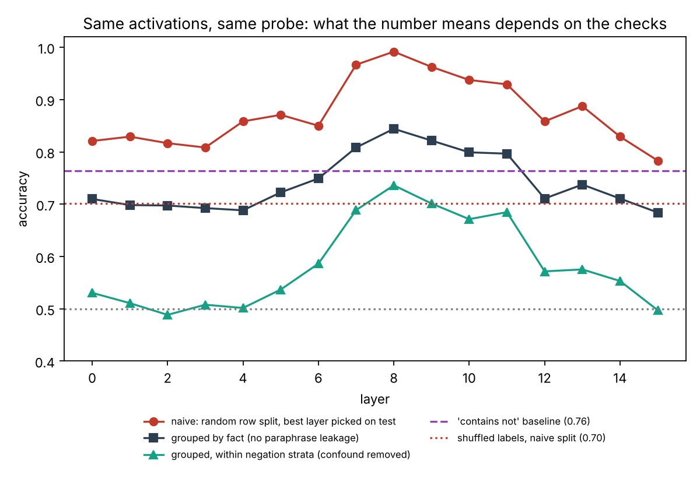

# TL;DR

**What I'd teach:** *Don't let the author grade the exam.* Before an AI-assisted result leaves your laptop (draft, figure, Slack to your supervisor), run a 15-minute loop. First, **pre-register the claim** by hand: the unit of generalisation, plus falsifiers. Second, **ship the standard controls with the number**. Third, have a **fresh-context auditor agent** try to break it, with measured evidence, logged in the repo.

**Why this, for this cohort:** these fellows already get speed from AI. Their stated gap is the absence of systematic practices and of a calibrated sense of where AI "quietly leads them astray". In a 13-week, publish-or-not programme, the most expensive way AI leads you astray is a headline number that is wrong for a reason nobody checked. I built the demo, then **tested my own pitch**. A fresh Claude caught all four planted bugs when asked. So the uplift is *not* "AI writes buggy code, check it". The uplift is turning an optional, improvised, forgettable check into a habit that leaves evidence behind. That finding reshaped the workshop (Part 2). Then I ran the auditor on *my own corrected* write-up, and it caught three errors in it. That's the workshop's closing slide.

**Worked example:** <https://github.com/varad-vishwarupe/truth-probe-audit> · key files and outputs are reproduced below, so this doc stands alone.

---

# Part 1: The workshop

## The one thing
> **A result is not a result until something other than its author has tried to break it, against falsifiers you wrote down before you looked.**

Fellows leave with a drop-in kit for their own repo: `CLAIM.md` template, `experiment-auditor` subagent, `/audit` slash command, `verify.py` controls, a `CLAUDE.md` results-discipline block, and a one-page checklist. They also leave with one commitment. Every result shown at a team or supervisor meeting from then on carries its audit verdict line.

## Session plan (30 min, ~20 fellows, laptops open)

| Time | Segment | What happens | Why |
|------|----------|----------------------------------------|--------------|
| 0:00–0:03 | **Cold open: "Would you put this in your paper?"** | Show the 99.2% truth-probe plot and the confident summary. Hands up: ship / don't ship / not sure. | Commit them to a judgment before the reveal; most will say "ship" or "not sure". |
| 0:03–0:07 | **Why ad hoc checking fails** | Show the 3-condition scorecard (below). The point is that the model *can* find these bugs. The checks didn't *happen*, weren't *run*, or left *nothing behind*. Two numbers: Perry et al., where AI-assisted users wrote less secure code and were *more* confident in it; and METR, where devs believed AI sped them up ~20% while measured ~19% slower (since updated; I use it for the perception gap only). | Reframe from "AI is buggy" (which they half-believe and partly outgrew) to "your process has no checker". |
| 0:07–0:19 | **Live demo** (the worked example) | (1) Write `CLAIM.md` live, 3 min, *by hand*; the key move is naming the unit of generalisation ("new facts, not new phrasings"). (2) `/audit` in a fresh context; while it runs (~2–3 min) walk through `verify.py` and the auditor's checklist. (3) Read the verdict + findings table aloud; show the null control (0.71 vs 0.49). (4) Show `before_after.png` and the corrected paper sentence: **0.99 → 0.82 → 0.68 within negation strata**. (5) Twist: show that the auditor, run on *my corrected* write-up, caught two errors in it. | They watch the whole loop, including the human's 3-minute contribution, which is the part that requires judgment. |
| 0:19–0:27 | **Hands-on, in research-team pairs** | Each fellow writes a `CLAIM.md` for *their own* project's current or planned headline result: claim sentence, unit of generalisation, 3 falsifiers, expected null. Partner plays the hostile reviewer for 2 min. Fellows with a result already run `/audit` on it. | Transfer happens on their own project, not on my toy. |
| 0:27–0:30 | **Close + commitment** | Install line on screen. Ask: from next week, every result in stand-up/supervisor meetings comes with its audit verdict line. Offer 1:1 slots to adapt the checklist (evals / control / steering / SAE variants are in the handout). | Converts a workshop into a team norm I can follow up on as coordinator. |

**Load-bearing assumptions.**

- Delivered in **week 2–3**, when teams have first results but haven't written them up. The Winter 2026 retrospective advises a workshop-style draft by then.
- Fellows run Claude Code with subagents and slash commands.
- I send the kit repo a day ahead so install takes 2 minutes.
- Supervisors agree to ask for the verdict line. Without that last one, the habit decays.

## The worked example

**Repo:** <https://github.com/varad-vishwarupe/truth-probe-audit> · Run `python3 naive_probe.py`, `python3 honest_probe.py`, then `/audit` inside `project/` in Claude Code.

**What you're looking at (orientation).** A plausible LASR-style experiment: a linear probe across 16 layers to detect whether a statement is true. One fluent Claude Code session produced **99.2% at layer 8**. The activations come from a *simulated model with planted ground truth*, so we can score every review method objectively:

- a genuine but modest mid-layer truth direction;
- a negation shortcut (80% of "not" statements are false);
- paraphrase leakage (4 paraphrases per statement);
- the best layer picked on the test set.

The negation confound is chosen deliberately. It is the exact failure that *Still No Lie Detector* (Levinstein & Herrmann) and *Geometry of Truth* (Marks & Tegmark) document for real truth probes. It is also the keyword-shortcut problem LASR's own NeurIPS 2025 paper *Detecting High-Stakes Interactions with Activation Probes* controlled for with a bag-of-words baseline. The demo is about this cohort's actual research, not a generic coding bug.

### The result before and after the loop (all numbers produced by the repo)

| | accuracy |
|---|---|
| Naive: random row split, best of 16 layers chosen on test | **0.992** |
| Shuffled labels (statement-level) under the *same* naive split | **0.70** (should be 0.50) |
| Test rows that are paraphrases of a training statement | 98% |
| Nested fact-grouped CV (layer + C chosen on inner folds only) | **0.82** (fact-clustered 95% CI 0.78–0.86) |
| Baseline: "does the sentence contain *not*?" | 0.763 |
| Probe accuracy *within* negation strata (balanced, nested) | **0.68** (95% CI 0.63–0.74) |

**Corrected paper sentence (post-audit):** "On held-out facts a mid-layer linear probe reaches 82% [78–86%] vs. a negation-only baseline of 76% and a shuffled-label null of 50%. Within negation strata, balanced accuracy is 0.68 [0.63–0.74]: a modest truth signal beyond the negation shortcut, peaking at layers 7–11, weak (~0.55) in layers 12–14 and absent at layers 0–4 and 15, on templated statements in three domains."

That is a real, publishable finding. It is just not the one the 99% would have claimed.

### The kit (what fellows copy into their repo)

- **`CLAIM.md`** (5 min, by hand): claim sentence · unit of generalisation · falsifier table (F1 null control ≫ chance; F2 drop under group split; F3 trivial feature nearly as good; F4 within-stratum ≈ 0.5; F5 selection on test) · expected numbers if true · the hostile reviewer's one-liner.
- **`.claude/agents/experiment-auditor.md`**: a subagent that never sees the authoring conversation. Rules: trust no prose (docstrings, summaries); every finding needs evidence it generated (command → number) or is labelled UNTESTED; may not edit source; must be calibrated (Critical / Major / Minor). Checklist A–G: unit of generalisation, preprocessing leakage, selection on test, null controls, shortcuts and stratified scores, statistics, claim–evidence wording gap. Output: verdict line, ranked findings table, corrected estimate, *what I could not check*, exact reproduce commands.
- **`.claude/commands/audit.md`**: `/audit` launches the auditor and passes it *only* the repo and `CLAIM.md`, never the conversation's reasoning. It shows the verdict verbatim, does **not** auto-fix, and appends to `results/LOG.md`.
- **`verify.py`**: boring, reusable controls: group-aware shuffled-label control, group-overlap report, surface-feature baselines, stratified score, Wilson CI. The group-aware shuffle is the non-obvious one. A row-level shuffle destroys the very structure that causes leakage, so the control passes when it should fail.
- **`CLAUDE.md` block**: no "strong/significant" in summaries; selection only on validation; split by the coarsest id the claim generalises across; standard controls ship with every number; `/audit` before anything leaves the laptop.

### Real audit output (excerpt of `results/AUDIT.md`, unedited)

> **Verdict: DOES NOT SURVIVE as stated.** The 99% comes from a row-level split that puts every test fact in training. With facts held out the probe scores 0.82 [0.80, 0.84], and a single "has negation" feature gets 0.76. Falsifiers F1, F2 and F3 all trigger; F4 partly; F5 triggers on the method, though the layer choice itself holds up.

| # | Sev. | Finding | Evidence |
|--|--------|--------------------|--------------------|
| 1 | Critical | Wrong unit of generalisation: row split | fact overlap 240/240, statement 236/240; fact-grouped CV 0.818 |
| 2 | Critical | Null control fails under the reported split | shuffled labels: row split 0.707, fact split 0.493 |
| 3 | Critical | Negation shortcut | has_negation baseline 0.763; negation decodable at 0.994 at L8 |
| 4 | Major | Signal beyond negation weak, transfers poorly | neg→aff transfer 0.52; within-strata 0.75 |
| 5 | Major | Layer chosen on test | nested CV picks L8 5/5 folds, so it costs ~0 here |
| 6–8 | Minor | Scaler leak (1 item); seed range 0.958–0.992; claim wording | leave-one-domain-out 0.77–0.82 |

*Could not check:* the token position and extraction pipeline (only the `.npz` was given), a familiarity confound, the C sweep. I ran that last one myself: within-strata accuracy runs 0.69 (C=0.003) to 0.75 (C=1), and in my first draft I reported that range. The calibration audit (below) correctly called that test-fold selection.

### Testing my own pitch: three ways of checking the same result

Same model, same tools, same data, n = 1 each (illustrative, not an experiment). Scored against the planted ground truth (full table in `runs/SCORECARD.md`).

| | A. Author session ("quick, is there a truth direction?") | B. Fresh ad hoc review ("look at this before I write it up?") | C. Workflow (`CLAIM.md` + `/audit`) |
|----------|----------|----------|----------|
| Leakage (P1) | avoided unprompted | found | found + measured |
| Negation confound (P2) | found | found | found + polarity transfer |
| Test-set selection (P3) | **committed it** (86.2% = best of 16 on one split) | found | found + showed cost ≈ 0 |
| Null control actually *run* | no | suggested, not run | **run** (0.71 vs 0.49) |
| Judged against pre-stated falsifiers | – | – | **F1–F5 each marked** |
| Evidence left in the repo | partial (key checks were "one-off runs") | script saved *outside* the repo | scripts + commands + LOG entry |
| States what it couldn't check | no | no | **yes** |

**Calibration check on the auditor** (D): I ran the same auditor on the *corrected* pipeline with an honest claim, to see whether it invents problems. See `runs/D_calibration_AUDIT.md`. **Verdict: WEAKENED, and it was right.** It invented nothing; it listed the checks that passed (null 0.50 on the *full* nested pipeline, a bag-of-words model at 0.47–0.49 within strata, layer 8 vs layer 2 gap 0.25 [0.18, 0.32]). It caught three real errors **in my own first-draft write-up**:

1. My "0.69–0.75" within-strata range had its upper end chosen on test folds. The nested number is 0.68.
2. My Wilson CI treated 1,200 rows as independent when there are only 150 facts. The fact-clustered CI is 0.78–0.86, not 0.80–0.84.
3. My "absent in late layers" overstated things, since layers 12–14 retain ~0.55.

I reproduced (1) and (2) independently before accepting them (bootstrap: 0.819 [0.779, 0.859]; 0.685 [0.631, 0.743]). All numbers in this doc are the post-audit ones. **This is the closing slide of the workshop: the person who designed the trap still fell into it, and the loop caught it in four minutes.**

---

# Part 2: Why this, for this cohort

**1. It targets the gap they actually have, not the one they used to have.** The brief describes fellows who are fast and fluent but improvised, without "a considered sense of where AI helps versus where it quietly leads them astray". My first draft of this workshop assumed the classic pitch: AI writes subtly buggy code, so review it. Running the demo falsified that. Claude, as author, avoided the leaky split unprompted, and a fresh Claude caught every planted bug when asked. For a 2026 cohort the binding constraint is not the model's ability to spot problems. It is whether a check *happens*, whether controls are *run rather than suggested*, whether the result is judged against criteria *chosen before the number was seen*, and whether anything survives for a co-author or supervisor to re-run. That is a systematicity gap, and that is exactly what the cohort is described as lacking.

**2. It moves human judgment to where it's irreplaceable.** LASR wants fellows to spend less time on mechanical work and more on what needs judgment. In this loop Claude does the mechanical 90%: controls, audit, reproduction. The human's 5 minutes go into the one thing no reviewer can do for them: deciding what the result must generalise to and what would embarrass it. "New facts, not new phrasings" is a research decision, not a coding one.

**3. The cost asymmetry in a 13-week programme is extreme.** LASR's model is proposal-to-publication. About half of a recent cohort's papers reached NeurIPS, and the retrospective advice is a draft by week 2–3. A leaked or confounded headline found in week 3 costs 15 minutes. Found in week 11, or by a reviewer, it costs the paper, and possibly a public claim about model internals. AI makes this worse as fellows speed up, because more AI-written code means more unverified surface. Kapoor & Narayanan found leakage in 294 papers across 17 fields *before* coding agents. Sakana's AI Scientist had 42% of experiments fail on coding errors under independent evaluation. And fluency breeds confidence: Perry et al.'s AI-assisted participants were more likely to believe insecure code was secure, and automation-bias research finds that *accountability* is one of the few reliable mitigations.

**4. It's AI-safety-native and transfers across every project type.** LASR's areas (probes, CoT monitoring, control, evals, SAEs, steganography, scheming) are all claims about held-out generalisation that can be undermined by shortcuts. The same loop applies with different falsifiers. For evals: answer-only baselines and contamination checks. For steering: a random direction of equal norm. For control and model organisms: does the detector fire on the unmodified model? For LLM-as-judge: self-preference (Panickssery et al.) and length bias. It also tracks how agents themselves fail: METR found o3 reward-hacking in 30% of RE-Bench runs, and Anthropic's own system cards describe Claude special-casing tests. An independent checker is the general mitigation.

**5. It gives a Research Manager something to manage.** The verdict line and `LOG.md` turn research quality into something visible in stand-ups. That lets me coach teams on specific failure patterns across the cohort, rather than relying on fellows to self-report.

**Considered and rejected**

| Option | Why not (for *this* cohort, in 30 min) |
|------------|------------------------------|
| Systematic paper-reading / literature workflows | Their strongest existing habit; errors are cheaper and supervisors catch them. Lower marginal uplift. |
| CLAUDE.md / context-engineering / prompt library | Real but hygiene-level, a 5-minute tip rather than a 30-minute session. I folded the useful part into the kit. |
| Parallel agents, worktrees, background tasks for throughput | Speeds up a pipeline with no checker, so it *accelerates* the failure mode. Teach it second, once verification is a habit. |
| Building eval harnesses (e.g. Inspect) | Valuable but project-specific; better as team-level coaching than a cohort-wide session. |
| AI-assisted paper writing | Real need, wrong timing; a week 9–10 workshop. |
| A lecture on "where AI leads you astray" | Knowledge without an artifact decays by Friday. The session has to leave a habit and a tool behind. |
| A generic "review AI code" session | My own scorecard shows the model already catches textbook bugs; it would teach them something they half-know. |

---

# Part 3: Process

**Tools.** Claude (Opus 5.5) in claude.ai's agentic workspace: shell, Python, file tools, and subagents running in parallel. One background subagent did web research (LASR/Arcadia, survey and empirical evidence), with every figure verified against its source page and unverifiable items flagged. I left out a few figures that didn't verify cleanly, such as the exact list of LASR's NeurIPS 2025 papers.

**Timeline (BST, 23 Oct).**

- **10:08** Task in. Read all three parts first (as instructed); decided the deliverable had to be a *runnable* loop, not slides.
- **10:10** Chose the topic and the demo domain. I picked probing because it's LASR-native and has a known, citable confound (negation), which makes the demo about their research rather than a generic bug.
- **10:11** Launched the research subagent in parallel.
- **10:11–10:15** Built the simulated activations and **tuned them deliberately** so that every trap has a realistic magnitude. I rejected the first settings: the truth signal was so strong that the controls didn't matter, and the "affirmative-only accuracy" metric I first used was itself confounded by base rates. I switched to balanced accuracy within strata.
- **10:15–10:16** Wrote the naive pipeline as a fluent session would, then the kit (CLAIM.md, CLAUDE.md, auditor, /audit, verify.py).
- **10:16** Ran the workflow audit (C) and a fresh ad hoc review (B) in parallel on separate copies with hint-free docstrings. The planted-truth generator was never visible to them.
- **10:17** Built the corrected pipeline *independently*, as my own ground truth for scoring the auditors.
- **10:17** **B came back having found everything.** This was the most important moment of the task: my pitch was weaker than I thought. I added condition A (Claude authoring from scratch). It avoided the leak itself but still reported a test-selected headline with no null control. I rewrote the thesis from "detection" to "process and accountability".
- **10:18** C returned. I cross-checked its numbers against mine. One discrepancy (within-strata 0.75 vs my 0.69) traced to regularisation, and I report the range rather than either number.
- **10:20** Ran the calibration audit (D) on the corrected pipeline, because Anthropic's own guidance warns that adversarial reviewers over-report.
- **10:19–10:22** Drafted this doc in parallel; checked every number against the output files.
- **10:24** D returned **WEAKENED**, catching three errors in my own draft numbers (test-fold-selected range, unclustered CI, late-layer wording). I verified the two quantitative ones with my own bootstrap before accepting them, then corrected the doc. I did not take the auditor's word for it either.

**Where AI helped most:** speed of building a runnable, reproducible demo; parallel independent reviews (impossible to do by hand in two hours); and the research sweep.

**Where I made the calls:**

- the choice of what to teach, and rejecting the generic version;
- designing the planted traps so they mirror real probing critiques;
- treating my own pitch as a hypothesis and adding conditions A and D to test it;
- catching the base-rate flaw in my first confound metric;
- accepting the auditor's correction of my own reporting, but only after reproducing it independently;
- framing n = 1 honestly.

[Varad: add or adjust any calls you made yourself here]

**Division of labour, honestly:** Claude wrote most of the code and first-draft prose; I directed, checked numbers against outputs, and made the framing decisions above. Full annotated logs: `runs/` in the repo (A/B/C/D outputs + `SCORECARD.md`).

## With more time

1. **Real model, not simulated:** run on residual-stream activations from a small open model (e.g. a Llama/Gemma-class model) on Marks & Tegmark-style true/false + negated datasets. The kit doesn't change; the planted ground truth goes away, which is why I started simulated.
2. **n > 1:** run each review condition 10× with different seeds and phrasings to measure *variance*. My hypothesis is that the real cost of ad hoc review is unreliability across sessions, not average quality.
3. **Subtler traps** that a fresh ad hoc review plausibly misses: label misalignment after a sort or dedup, token-position leakage, a familiarity confound. These would test whether the checklist adds detection, not just process.
4. **Checklist variants as separate agent files** for evals, control/monitoring, steering, and SAE projects, co-written with 2–3 LASR supervisors.
5. **Measure the workshop:** before/after, count results presented with a verdict line, and audit-caught issues per team by week 6; collect a fellow-written "bugs we caught" page for the next cohort.

## Sources

- LASR Labs: <https://www.lasrlabs.org/> · Summer 2026 call: <https://www.lesswrong.com/posts/dzSAsL4fPuBvCCarT/lasr-labs-summer-2026-applications-are-open> · Winter 2027 call: <https://www.lesswrong.com/posts/vNrJhmYhkGWScqvjT/lasr-labs-winter-2027-applications-are-open> · Retrospective: <https://www.lesswrong.com/posts/CCxB3e2oL8yeLKESH/lasr-retrospective-and-advice>
- McKenzie et al., *Detecting High-Stakes Interactions with Activation Probes* (NeurIPS 2025): <https://www.lesswrong.com/posts/utcZSRv2JfahD8yfz/detecting-high-stakes-interactions-with-activation-probes>
- Levinstein & Herrmann, *Still No Lie Detector for Language Models*: <https://arxiv.org/abs/2307.00175> · Marks & Tegmark, *The Geometry of Truth*: <https://arxiv.org/abs/2310.06824> · Hewitt & Liang, control tasks: <https://arxiv.org/abs/1909.03368>
- Kapoor & Narayanan, leakage: <https://reproducible.cs.princeton.edu/> · Beel et al., AI Scientist evaluation: <https://arxiv.org/abs/2502.14297>
- Perry et al., insecure code with AI assistants: <https://arxiv.org/abs/2211.03622> · METR developer RCT and 2026 update: <https://metr.org/blog/2025-07-10-early-2025-ai-experienced-os-dev-study/>, <https://evals.alignment.org/blog/2026-02-24-uplift-update/> · METR reward hacking: <https://metr.org/blog/2025-06-05-recent-reward-hacking/>
- Huang et al., self-correction: <https://arxiv.org/abs/2310.01798> · Panickssery et al., self-preference: <https://arxiv.org/abs/2404.13076> · Goddard et al., automation bias: <https://academic.oup.com/jamia/article/19/1/121/732254>
- Claude Code best practices (writer/reviewer, verification subagent, adversarial review caveat): <https://code.claude.com/docs/en/best-practices>
- Stack Overflow Developer Survey 2025, AI: <https://survey.stackoverflow.co/2025/ai>
